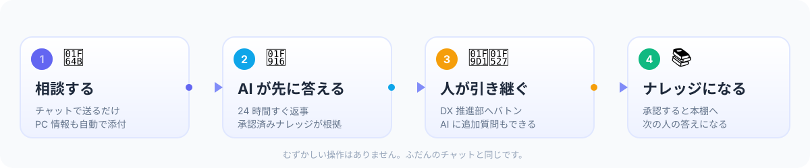
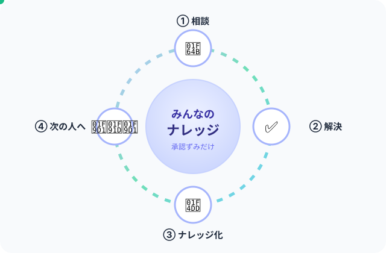

<div align="center">



<br><br>

**「PC が動かない」「この作業、どうやるの？」を、ひとつの窓口で。**

<a href="https://ai-helpdesk.mirai-dx-platform.com"></a>


</div>

> [!WARNING]
> これは **試作版（MVP）** です。会社の正式システムではありません。
> 「こんなふうに使える」を確かめるためのものなので、本番の業務データは入れないでください。

---

## 🍀 これは、なに？

社員のみなさんの「困った！」を **1 つの窓口** で受け付けて、
**AI が先に答え、むずかしい話だけ人が引き継ぐ** しくみです。

いまは、聞き先がバラバラになりがちです 👇

```
メールに書く 📧 ／ 電話する 📞 ／ 直接たずねる 🚶 ／ チャットする 💬
        ↓
  担当者が毎回おなじことを聞く（型番は？ OS は？ いつから？）
        ↓
  解決しても、その知識は担当者のなかに残るだけ 😢
```

この窓口では、こう変わります 👇

```
ひとつの窓口に書く 💬（PC の情報も自動で添付）
        ↓
AI が答える 🤖／印刷の相談は端末の状態を読み取って確かめる 🔍
（目指す形は「その場で直す」。修復の多くはまだデモです）
        ↓
最後に決めるのは人。押すのは「Y」か「N」だけ ✋
        ↓
本人が解決と判断 ✅ ／ 直らなければ DX 推進部へバトン 🧑‍🔧
        ↓
解決した内容を別のアカウントが承認すると「ナレッジ」になり、次の人の相談の根拠になる 📚
```

> [!NOTE]
> この図は目指す流れです。線ごとに **実データ／デモ／未接続／未検証** のどれかを
> [docs/65 対応表](docs/65-readme-dataflow-map.md) に書いています。

---

## 😵 こんなことで、困っていませんか？

| いまの困りごと | この窓口だと |
|---|---|
| 🙋 聞きたいけど、誰に聞けばいいか分からない | 🤖 まず AI が 24 時間すぐ答えます |
| ⏰ ヘルプデスクが混んでいて、返事が遅い | ⚡ 自由に書いた相談には AI がその場で答えます（定型の相談の一部はまだデモデータです） |
| 🔁 同じ質問が、何度も何度も来る | 📚 別のアカウントが承認した内容が、次の人の相談の根拠になります（自由記述と、端末エージェントが接続された印刷の相談） |
| 🖥 「PC の型番は？」と毎回聞かれる | 📋 PC の基本情報が、自動で添付されます |
| 😰 引き継ぐたびに、最初から説明し直す | 🧑‍🔧 ここまでのやりとりが、そのまま引き継がれます |

---

## ✨ できること（4 つ）

**1. 🙋 相談する**
チャットに書くだけ。むずかしい設定はありません。PC の基本情報も自動で付きます。

**2. 🤖 AI が答えて、その場で直す**
自由に書いた相談には、**社内のナレッジ** と PC の情報を根拠に AI が答えます（ナレッジの出所は回答に表示します）。
**印刷の相談** は、端末エージェントが接続されていれば読み取り診断へ進みます。実行するかは **本人が「Y」か「N」で決めます**。
ほかの定型の相談（VPN・音声など）の診断と修復は、まだ **デモデータ** です（画面にもそう表示します）。

**3. 🧑‍🔧 直らなければ、人が引き継ぐ**
直らないときは、本人が共有の範囲に同意して **DX 推進部** へバトンを渡します。
そのとき、同意した範囲の引継ぎ要約が自動で作られます。
宛先はグループで、必要なら名簿から担当者を選ぶこともできます（自由入力ではありません）。
届いた人は受信箱から選んで引き受け、**AI に追加で質問**することもできます。

**4. 📚 ナレッジになる**
解決した内容は、**別のアカウントが承認して** はじめて AI の根拠になります。
いま届くのは、自由記述の相談と、端末エージェントが接続された印刷の相談です（[docs/65](docs/65-readme-dataflow-map.md) §5）。

<br>



> [!NOTE]
> 図は目指す流れです。「AI が答えて直す」のうち修復はまだデモで、「次の人の答えになる」は、AI の根拠や出典として届くところまでです。次の人が自分で解決できるかはナレッジの手順の書き方次第です（[docs/65](docs/65-readme-dataflow-map.md) §7）。

---

## 🤖 AI は、どこまでやる？（いちばん大事なところ）

「AI がその場で直す」と聞くと、少し不安になりますよね。範囲と、いま本当に動いているところは次のとおりです。

| | やること | 人の関与 | いまの実態（線ごとの証跡は [docs/65](docs/65-readme-dataflow-map.md) §3） |
|---|---|---|---|
| 💬 **答える** | 症状の整理・確認・手順の説明 | なし（読むだけ） | 自由記述は実 AI。定型の相談はルールとデモデータ。印刷の相談は AI の回答なし |
| 🔍 **調べる** | PC の基本情報・**読み取りだけ**の診断 | 基本情報はなし。読み取り診断は本人の Y | 基本情報はブラウザから実取得。読み取り診断は印刷の相談だけで、模擬の実行器でしか通していません（実端末は未検証） |
| 🛠 **直す** | **許可リスト**の操作を提案し、実行する | **本人が Y / N**（Lv4 の操作は管理者の承認も必要） | 提案カードの実行は模擬です。実機での実行の記録はまだありません |
| 🚫 **やらない** | 許可リスト外の操作・権限の付与・セキュリティ機能の停止・一括削除・勝手な再起動 | 提案そのものを作らない | |

- 🖐 **押すのは「Y」か「N」だけ。** 実行するかどうかは、必ず本人が決めます。読み取り診断では、他人の Y・古いハッシュ・二重の Y・取消後の Y をサーバーが拒否します（模擬の実行器で確認）。
- 🔁 **回数の上限。** 提案カードは 1 相談あたり 15 回まで（画面側）、読み取り診断は 6 提案・30 分まで（サーバー側）です。
- 📝 **提案カードの「N」と引継ぎ要約は、デモの動作で今回は確かめていません。** 読み取り診断の「N」は止まるだけで、要約は作りません。
- 🛡 **実行前の確認。** 読み取り診断はサーバーで確かめます。提案カードの「実行前検証」は画面だけのデモです。
- 🔍 **読み取りが成功しただけでは「解決」になりません。** 解決かどうかは本人が決めます。
- 🖥 **実機での修復の実行は、まだ確かめていません。** 提案カードの操作はプロトタイプ内の模擬実行です。印刷スプーラーの再起動だけ実機向けの経路がありますが、実行の記録が無く、印刷の相談が読み取り診断へ変わったので画面の入口も無くなりました。

### 🛠 「修復・作業の提案カード」って？

STEP 3「AI 一次対応」のチャットの中に、**何を実行するか** まで書いたカードが出ます。
いまのカードは決定ルールとデモデータから作ったもので、印刷以外の定型の相談で出ます（画面に【デモデータ】と表示します）。

| カードに載るもの | 例 |
|---|---|
| 🛠 **操作** | 印刷スプーラサービスの再起動（`SPOOLER_RESTART`） |
| 🎯 **対象** | 自分の PC のプリンター |
| ⚠️ **影響** | 再起動中（約 30 秒）は印刷できません。待機中のジョブは保持されます |
| ↩️ **戻し方** | 再起動のみ（失敗したら担当者へ引き継ぎ） |
| 🔐 **必要な承認** | 本人の Y ＋ IT 管理者の承認 |
| #️⃣ **承認ハッシュ** | 内容が変わると承認が無効になる番号 |

本人にだけ、次の 3 つが出ます。

- **Y：この操作を承認**
- **N：実行しない**
- 🙋 **担当者に相談**

押したあとは、こうなります。

```
Y →（管理者の承認が必要な操作なら承認待ち）→ 実行前の確認 → 実行（模擬）
   → 結果（デモデータの例）
   → 「✅ 解決した」／「🙋 まだ困っている」→ 必要なら「元に戻す」
N → 何も実行しません（端末は変更なし）→ 引継ぎ要約を自動で作成
```

> 💡 カードの確認は画面の状態で行うデモです。サーバーで確かめるのは読み取り診断（解決ループ）の経路です。


---

## 🧭 つかいかた（3 ステップ）

### 1. 相談する 🗣️

窓口をひらいて、ふだん話すように書くだけです。

> 例：「昨日から社外の共有フォルダが開けません。Windows 11 です。」

画面が PC の基本情報（OS・メモリ・空き容量など）を自動で集めます。
**見るだけで、変更はしません。**

### 2. AI の答えをためす（その場で直せるものは直す）🤖

自由に書いた相談には、AI が社内のナレッジをもとに手順を返します。
印刷の相談は、端末エージェントが接続されていれば読み取り診断へ進み、なければ「実診断はできません」と案内します。
定型の相談の提案カードは、デモデータの模擬実行です。
やってみて、**解決した／しなかった** をボタンで選びます。

### 3. 直らなければ、人へ 🧑‍🔧

共有する範囲に同意して宛先を選ぶと、DX 推進部へ引き継がれます（勝手には渡しません）。
引き継ぎメモに、同意した範囲のやりとりと PC の情報が入るので、
**同じことをもう一度説明する必要はありません。**

---

## 📚 ナレッジは「ぐるぐる」回ります

1 回の解決が、次の人の時間を短くします。



図の「④ 次の人へ」は、AI の根拠や出典として届くところまでです。

- 🧑‍⚖️ AI の根拠になるのは、**DB に承認の記録があり、作成者と承認者のアカウントが別のものだけ** です（ブラウザの中のナレッジや自己承認は使いません）
- 🏷 出所は分けて表示します: 別の担当者が承認／同一人物の別アカウントが承認／初期登録の資料（人の承認記録なし）
- 🎯 届くのは **自由記述の相談** と、**端末エージェントが接続された印刷の相談**（読み取りの結果の後に出典付きで案内）です。未接続の印刷の相談には届きません
- 🏷 AI が使ったと答えたものだけ「AI が参照しました」と出します。一致しただけのものは、そう書きます
- 🙈 下書きの症状は相談内容だけから作ります。メールアドレス、電話番号、端末の番号、ホスト名なども **保存前に自動で伏せ字** にし、残っていれば承認できません。形で分からないホスト名などもあるので、最後は承認者が本文を確認します（[docs/64](docs/64-kb-approved-provenance.md) §8）
- 📈 「役に立った率」はその人の画面の中だけの記録で、全体には集計されていません

---

## 🔒 安心して使うために

| 気になること | どうなっているか |
|---|---|
| 🔍 PC の情報を勝手に見られない？ | **読み取りだけ**です。ファイルの中身・閲覧履歴・画面・キー入力・メール本文は取りません |
| 🙈 個人情報は大丈夫？ | メール・電話・IP・カード番号などを **自動で伏せ字** にしてから保存・送信します |
| 🔑 誰でも使える？ | **社内の人だけ**です。Cloudflare Access のログイン＋許可リストで判定します（許可外は全拒否） |
| 🧑‍⚖️ AI の答えが間違っていたら？ | ナレッジとして残す前に、必ず別の人が承認します。AI の回答そのものは確認なしで表示されます |
| 🖐 勝手に操作されない？ | されません。遠隔サポート（担当者）は **案内文を送るところまで**。読み取り診断も **本人の Y** があるときだけ動きます |
| 📤 共有は同意した分だけ？ | 担当者へ渡すのは **同意した範囲だけ** です（画面の項目ごとに外せます）。ナレッジの下書きには端末の番号や PC 基本情報を入れません（[docs/64](docs/64-kb-approved-provenance.md) §8） |

---

## ❓ よくある質問

<details>
<summary><b>🙋 パソコンに詳しくなくても使えますか？</b></summary>

はい。やることは「チャットに書く」と「解決した／しなかったを選ぶ」だけです。
専門用語はなるべく画面に出さないようにしています。

</details>

<details>
<summary><b>🤖 AI の答えは、どこから来ているの？</b></summary>

自由に書いた相談は、DB にあるナレッジと、相談者さんの PC の基本情報です。ナレッジには、別の担当者が承認したもののほか、同一人物の別アカウントが承認したものと、初期登録の資料（人の承認記録なし）があり、回答に出所を表示します。
定型の相談（VPN・音声など）は AI ではなく、決定ルールとデモデータです。画面の表示で区別しています。
それでも間違うことはあるので、最後は人が確認します。

</details>

<details>
<summary><b>⏱ どれくらいで返事が来ますか？</b></summary>

AI の一次対応は、ふつう **数秒** です。
人に引き継いだ場合は、DX 推進部の受付時間内での対応になります。

</details>

<details>
<summary><b>🔐 相談した内容は、誰に見られるの？</b></summary>

相談そのものは、自分自身と、対応する DX 推進部の担当者です。
ナレッジにする場合は、下書きの本文を承認者（DX 推進部以外を含む）が読みます。承認されると、伏せ字のうえで別の人の相談の根拠になり、外部の AI へ送られます。
「操作する人」の切り替えはデモ用の機能で、実際のログインは Cloudflare Access のみです。

</details>

<details>
<summary><b>🖥 自分の PC 以外の情報が混ざったりしませんか？</b></summary>

PC 情報の画面では混ざりません。端末ごとに分けて保存し、いま見ている PC の情報だけを表示します。
ナレッジを通じて別の人の端末情報が AI の入力へ渡らないように、下書き、保存、承認、AI への送信の各段階で除いています。修正より前に保存された行の本文には残ることがあり、件数は読み取り専用スクリプトで確認します（[docs/64](docs/64-kb-approved-provenance.md) §8）。

</details>

<details>
<summary><b>📚 ナレッジは誰が承認するの？</b></summary>

申請した人とは **別のアカウントの承認者** が確認します。自己承認のものは AI の答えの根拠にしません。同一人物の別アカウントの承認と初期登録の資料は根拠に使っていて、出所を分けて表示します（この方針はユーザーの判断待ちです。[docs/64](docs/64-kb-approved-provenance.md) §9）。
画面から承認できるのは DX 推進部の承認者だけで、ほかの承認者は画面を開けません。案件の完了の承認にも、別の人の画面からの導線がありません（[docs/65](docs/65-readme-dataflow-map.md) §5）。

</details>

---

## 🚦 いまの状態（正直なところ）

**実データ** は固定データを通らず保存先まで届く線、**デモ** は原本の固定データ、**未接続** は部品はあるが画面からつながっていない線、**未検証** は確かめていない線です。
線ごとの証跡と、main・各 PR のどこで成立するかは [docs/65 対応表](docs/65-readme-dataflow-map.md) にあります。

| できること | 状態 |
|---|---|
| 💬 自由記述の相談 → AI の回答（社内のナレッジが根拠） | ✅ 実データ（実 AI で 1 回確認） |
| 💬 定型の相談（VPN・音声など）の診断と提案 | 🎭 デモ（画面にデモと表示） |
| 🔍 PC 基本情報（ブラウザ） | ✅ 実データ |
| 🔍 PC の詳しい情報（端末エージェント） | ❔ 未検証（試験のみ） |
| 🔍 印刷の相談の読み取り診断（本人 Y → 結果 → 解決とは判定しない） | 🟡 検証環境の Windows 端末 1 台で実行を確認（`spooler.status` のみ。認証と名簿は検証用）。本番は未反映 |
| 🛠 AI がその場で直す | 🎭 デモ（提案カードは模擬実行）。実機の実行は未検証 |
| 🧑‍🔧 引継ぎ（同意 → 宛先 → 受信箱 → 引き受け → 解決記録） | ✅ 実データ |
| 📚 ナレッジ下書き → 申請 → 別の承認者が承認 | ✅ 実データ（画面から承認できるのは DX 推進部の承認者だけ） |
| 📚 別のアカウントが承認したナレッジ → 次の人の AI 入力（自由記述） | ✅ 実データ（実 AI で確認。2 回のうち 1 回は別の KB を根拠に挙げ、もう 1 回はこの KB を挙げたうえで担当者への引継ぎを案内しました） |
| 📚 別のアカウントが承認したナレッジ → 次の人（印刷の相談、接続あり） | 🟡 経路は確認（スタブの AI と模擬の実行器まで。実 AI の提案は未検証） |
| 📚 別のアカウントが承認したナレッジ → 次の人（印刷の相談、未接続） | ⛔ 未接続 |
| ✔️ 案件の完了の承認（別の人の画面から） | ⛔ 未接続（API のみ） |
| 📄 最終報告書（HTML） | ✅ 実データ（画面の状態から生成。PDF は今回未確認） |
| 🖐 本人同意つきの遠隔サポート（案内文まで） | 🎭 同じログイン内のデモ |
| 🔔 引継ぎのメール通知 | ❔ 未検証（ローカル SMTP シンクまで） |
| 🖥 画面共有・遠隔操作 | 🚧 実装していません |
| 🧑 本人権限ヘルパーの共通支援セッション（#120） | 🚧 開発中のブランチ。既定無効で、この状態表の対象外 |
| 🧪 通しテスト（E2E） | 🟡 1 シナリオのみ（合成の名簿、ローカル認証、スタブ AI、模擬の実行器） |

> [!NOTE]
> 「実データ」でも、通しの確認は検証環境（合成の名簿・ローカル認証）で行っています。Cloudflare Access・実端末では確かめていません。
> スタブの AI と模擬の実行器で通したものは、実機の受入に数えていません。

---

## 🧑‍💻 エンジニア向け（たたんであります）

<details>
<summary><b>構成・起動・テスト・デプロイを見る</b></summary>

### 構成

```
Browser
  │  Cloudflare Access（OTP / 12h / 許可メールのみ）
  ▼
Cloudflare Tunnel  ai-helpdesk.mirai-dx-platform.com
  │
  ▼
Node 22 / Fastify  ai-helpdesk-api.service（127.0.0.1:18950）
  │  ├─ 既存プロトタイプ HTML を配信（boot / bridge / device-bridge / assist-bridge を注入）
  │  ├─ /api/state（prototype_states。AI の根拠には使わない）
  │  ├─ /api/device/browser・/api/device/inventory（実 PC 情報）
  │  ├─ /api/device/agent（端末エージェント / デバイストークン）
  │  ├─ /api/ai/answer（自由記述のみ。deepseek-flash + DB の別人承認ナレッジ + PC 情報）
  │  ├─ /api/resolve/*（印刷の相談の読み取り診断。本人 Y → device_commands → 端末エージェント）
  │  ├─ /api/case-handovers/*（引継ぎ）・/api/knowledge/*（下書き・承認）
  │  ├─ /api/reports/final（最終報告書: Standalone HTML / PDF）
  │  └─ /api/ai/remote-prompt（STEP5 の案内文下書き。実行はしない）
  ▼
Local PostgreSQL  ai_helpdesk_preview
```

UI は既存プロトタイプ `Mirai_AIHelpdesk_Cowork_StepWizard_V3.1_PCinfo_Offline.html` を
**そのまま配信** し、ブリッジ JS だけで状態保存・AI・実 PC 情報を足しています。

### ローカル起動

```bash
npm install
cp .env.example .env.local      # DATABASE_URL / SESSION_SECRET / SEED_PASSWORD を設定
chmod 600 .env.local

npm run db:migrate
npm run db:seed
npm run dev:api                 # http://127.0.0.1:18950/（開発モードは認証なし）
```

### 検証

```bash
npm run typecheck   # API + worker
npm run lint
npm test            # Unit / API integration（PostgreSQL テスト DB）
npm run build
bash scripts/scan-secrets.sh
npm audit --audit-level=high && npm audit --omit=dev --audit-level=high
```

### デプロイ（Preview）

```bash
set -a; . ~/.config/ai-helpdesk/api.conf; set +a
NODE_ENV=production npx tsx scripts/migrate.ts
npm run build
systemctl --user restart ai-helpdesk-api
```

### 端末エージェント（任意・読み取りのみ）

ブラウザ取得だけで足りない情報（導入ソフト・セキュリティ状態など）は、
端末エージェントで取得できます。Windows は **Node 不要** の PowerShell 収集タスクが使えます。

```powershell
powershell -ExecutionPolicy Bypass -File .\scripts\windows\install-collector-task.ps1 `
  -ConfigPath "$env:USERPROFILE\.config\ai-helpdesk\device-agent-windows.json"
```

- 収集: OS / CPU / メモリ / ディスク / GPU / ネットワーク / プリンター / 音声 / USB / 導入ソフト / セキュリティ状態
- 非収集: **ファイル内容 / 閲覧履歴 / 画面 / キー入力 / メール本文**
- 詳細: [docs/08-deployment.md](docs/08-deployment.md) §0-1 / [docs/09-operations.md](docs/09-operations.md) §6-1

### ドキュメント

- [初動 Assessment](docs/00-assessment.md) / [MVP Scope](docs/01-mvp-scope.md) / [Plan](docs/02-plan.md)
- [Database](docs/04-database.md) / [API](docs/05-api.md) / [Test](docs/06-test.md)
- [Security](docs/07-security.md) / [Deployment](docs/08-deployment.md) / [Operations](docs/09-operations.md)
- [受入照合](docs/11-acceptance.md) / [Round Log](docs/12-round-log.md) / [Blocker 報告](docs/13-blocked-report.md)
- [既存 UI の適用](docs/14-prototype-ui-integration.md) / [AI 修復フロー](docs/16-ai-repair-flow.md) / [端末コマンド実行](docs/19-device-command-execution.md) / [社員名簿](docs/20-employee-directory.md)
- [README のデータの流れの対応表](docs/65-readme-dataflow-map.md) / [Windows の端末エージェント（Node 不要）](docs/66-windows-command-agent.md) / [最終報告書](docs/21-final-report-export.md) / [STEP5 引継ぎと遠隔支援](docs/22-remote-assist-handover.md) / [RSP / MeshCentral 連携設計](docs/23-rsp-meshcentral-integration.md)
- [本人同意付きフォルダ一覧](docs/62-consented-folder-access.md)

### 既知の制約

- 線ごとの判定は [docs/65](docs/65-readme-dataflow-map.md)。通しの E2E は `scripts/e2e/dataflow-integration.mjs`（1 シナリオ。合成の名簿、`AUTH_MODE=local`、スタブ AI、`--mock`）です。他の相談、PDF、実端末、Access は通していません。
- 提案カードの実行前検証（本人の Y・Lv4 の管理者承認）は**画面側の状態**です。サーバーで検証するのは解決ループ（`/api/resolve/*`）の経路です。`SPOOLER_RESTART` の実機経路は実行の記録が無く、印刷の相談が解決ループへ変わったのでウィザードからの入口もありません。
- 端末エージェントは 1 ユーザー 1 端末（source 単位）の MVP です。複数端末の同時管理は未対応です。
- 引継ぎはサーバーに保存され、別アカウントへ届きます。メール通知は実装済みですが、送信には SMTP（または sendmail）の設定と再起動が必要です（[docs/22](docs/22-remote-assist-handover.md) §9-6）。
- 遠隔支援（案内文の送信）は同じログイン内のデモです。画面共有（MeshCentral 等）は未実装です。
- 最終報告書は画面の状態から生成します。サーバー側の案件台帳との突合・電子署名は未実装です（[docs/21](docs/21-final-report-export.md) §7-1）。
- 添付実体・端末修復実行・外部ヘルプデスク基盤連携・SSO は対象外です。
- 本人同意付きフォルダ一覧（[docs/62](docs/62-consented-folder-access.md)）は開発中で、既定で無効です（`FOLDER_ACCESS_ENABLED=false`。全 API が 404、画面の導線も出ません）。読み取り専用で、選んだフォルダ直下の名前と属性だけを扱います。Mirai-Info の貸与情報 API が `generatedAt` と鮮度の根拠 `dataAsOf.employeeDirectoryLastSeenAt` を返すまでは、検証環境の `FOLDER_ACCESS_ALLOW_UNVERIFIED_LEASE=true` でしか先へ進めません（本番では起動を拒否します）。
- 共通支援セッションと AI 操作ループ（[docs/63](docs/63-assist-session.md)）は開発中で、既定で無効です（`ASSIST_SESSION_ENABLED=false`。全 API が 404、画面の導線も出ません）。実行器は本人権限ヘルパーだけで、`device_commands` / RSP へ配送しません。追加の Skill は人の承認（`scripts/skills/approved.json`）があるまで提案されません。
- アクセス制御の正本は [docs/MailAddress.txt](docs/MailAddress.txt)。空・不存在の場合は **全拒否**（fail-closed）です。
  Cloudflare Access の allow ポリシーと同じ内容に保ち、変更時は両方を更新して API を再起動してください。

</details>

---

## 📄 ライセンス

未設定（個人利用の試作）。

---

<div align="center">
<sub>最終更新: 2026-11-01 ／ この README は「はじめて見る人」向けに書き直しました。技術的な正本は <a href="docs/">docs/</a> にあります。</sub>
</div>
